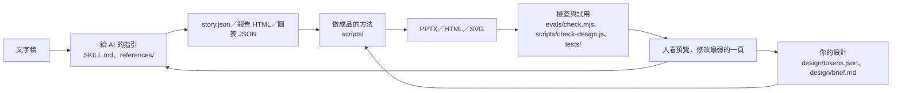

# Clayprint

Clayprint 把文字稿整理成有判斷與來源的簡報或 HTML 報告，也能替既有檔案套用設計層。三種用法：[文字稿 → 簡報](SKILL.md)、[文字稿 → HTML 報告](references/report.md)、[既有檔案套用設計層](references/formats.md)。

## 怎麼一起工作



簡報由 `scripts/pptx.js` 讀 `story.json` 與設計層；報告 HTML 依文字稿組成，再由 `scripts/theme-css.js` 套色；SVG 另讀圖表 JSON 與設計層。

| 片中說法 | 對應檔案 | 什麼時候改 |
| --- | --- | --- |
| 給 AI 的指引 | `SKILL.md`、`references/` | 用途、內容流程、支援範圍改變時 |
| 你的設計 | `design/tokens.json`、`design/brief.md` | 改顏色、字型、字級、線寬時 |
| 做成品的方法 | `scripts/` | 改圖種、版型或輸出方式時 |
| 檢查與試用 | `tests/`、`examples/`、`evals/` | 發現新問題或需要新範例時 |

## 安裝與 30 秒上手

需要 Node 24.2 以上。把**整個** Clayprint 資料夾放進專案的 skills 目錄：Claude Code 用專案內的 `.claude/skills/clayprint/`；Codex 放到 Codex 讀取專案 skills 的資料夾。`agents/openai.yaml` 提供 Codex 顯示名稱與預設提示，不是安裝設定。進入 Clayprint 資料夾後執行 `npm ci`。

```sh
mkdir -p out
node evals/check.mjs examples/story.json evals/fixtures/example-script.md
node scripts/pptx.js examples/story.json out/story.pptx
node evals/check-report.mjs examples/report.html evals/fixtures/explain-script.md
```

用瀏覽器開 `examples/report.html`。有 Mac 版 PowerPoint，或沒有 PowerPoint 但有 LibreOffice（`soffice`）時，安裝 `pdftoppm` 與 `ffmpeg`，執行 `node scripts/preview.js out/story.pptx out/preview`，逐頁看圖；LibreOffice 可能換用替代字型。兩者都沒有時，可執行 `node scripts/svg.js examples/rank.json out/rank.svg` 檢查圖表，再安裝 PowerPoint 或 LibreOffice 檢查整頁；SVG 不能代替簡報預覽。

## 改成你的

[改造步驟](docs/make-it-yours.md)：換外觀先改設計層；改內容流程、版型或圖種還會碰到指引、參考與程式。

## 已知限制

- [PowerPoint 編輯限制](docs/design-diff.md)：只有部分圖表能用「編輯資料」；SVG 圖表須改資料後重產。
- LibreOffice 預覽可能使用替代字型。PowerPoint 內的字型由設計層的 `font.slide` 決定（預設微軟正黑體）；字寬估算以正黑體校準，換字型後請看預覽確認換行，收件者電腦也要有該字型。
- 中文數詞與日期區間不自動核對，須回原稿人工查證。
- 檢查通過仍須看每頁的語意、遮擋與閱讀順序。

授權：[MIT](LICENSE)。範例資料均為虛構示意。
