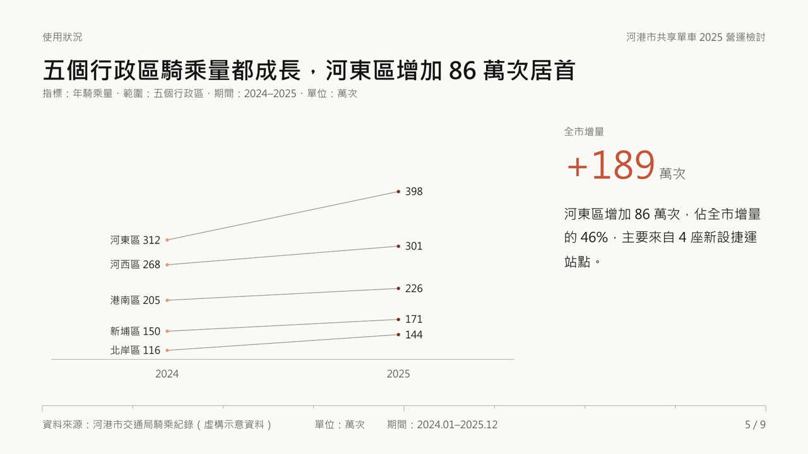
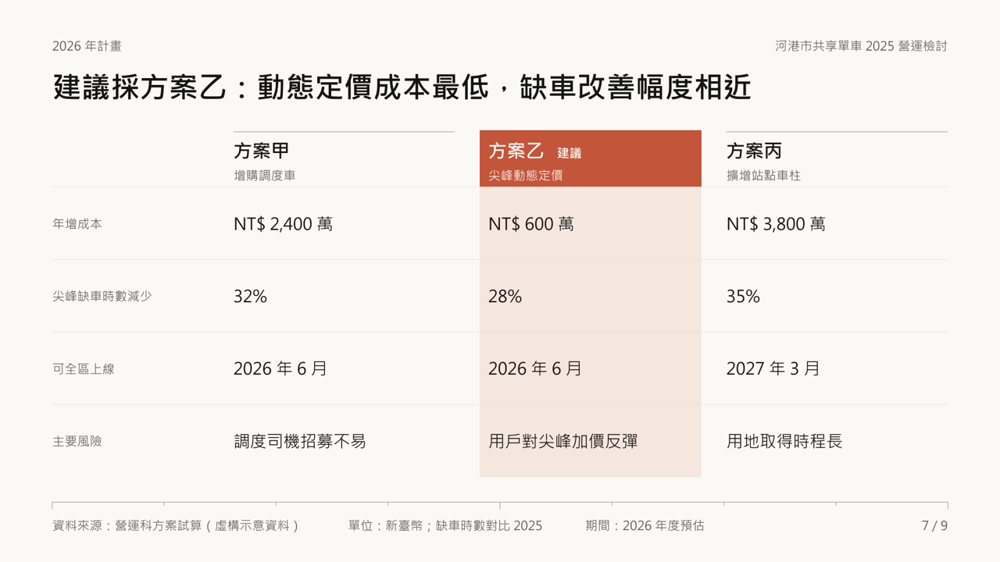
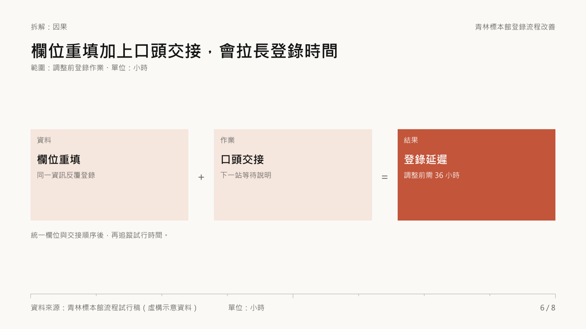
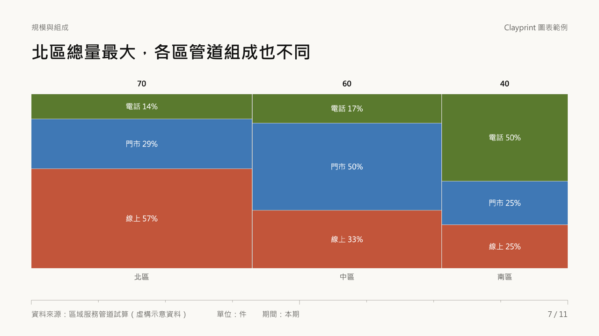
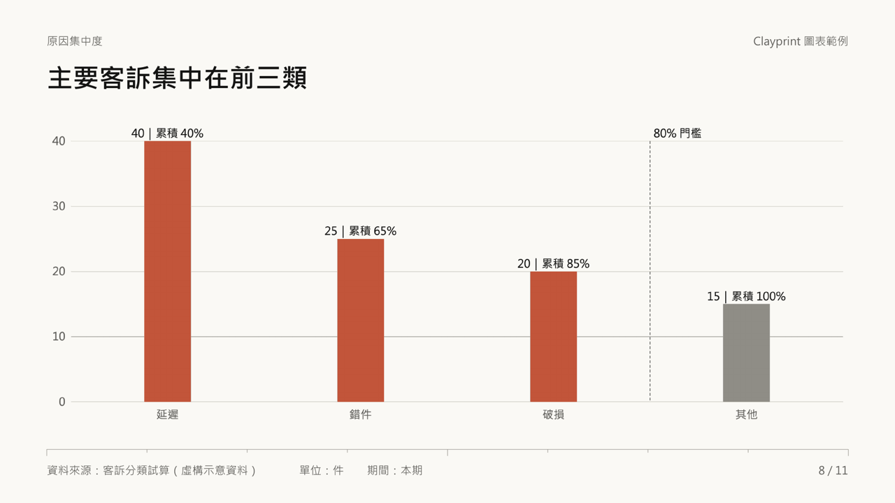
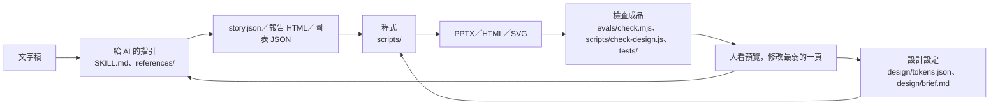

# Clayprint

Clayprint 把文字稿整理成提出判斷、附上來源的簡報或 HTML 報告，也能替既有檔案套用設計層。三種用法：[文字稿 → 簡報](SKILL.md)、[文字稿 → HTML 報告](references/report.md)、[既有檔案套用設計層](references/formats.md)。

介紹影片：[從需要，到自己的工具](https://youtu.be/dIQ2amlA6HY)（YouTube，8 分 39 秒）。講 Clayprint 怎麼從一次次不滿意整理出來，也講怎麼檢查 AI 做出來的成品；下方表格的「片中說法」就是影片裡的用詞。

## 範例

以下都由 `examples/` 裡的虛構範例直接產生，沒有手工修圖。每頁標題就是那一頁要支持的判斷，頁尾附資料來源、單位與期間。

| | |
| --- | --- |
|  |  |
| 斜線圖加重點數字（[營運檢討](examples/story.json) 第 5 頁） | 方案比較，建議選項整欄標色（第 7 頁） |
|  |  |
| 推行時程（第 8 頁） | 沒有數據時用因果拆解（[流程說明](examples/story-explain.json) 第 6 頁） |
|  |  |
| 規模與組成一張圖看（[圖表範例](examples/story-charts.json) 第 7 頁） | 柏拉圖標出 80% 門檻（第 8 頁） |

同一份流程說明也能做成 HTML 報告（[examples/report.html](examples/report.html)）：


要自己重現，安裝後執行 `node scripts/pptx.js examples/story.json out/deck.pptx`，再用 `node scripts/preview.js out/deck.pptx out/preview` 看整頁預覽。

## 怎麼一起工作

交給 AI 時，連同文字稿說明背景：給誰看、要支持什麼判斷或決定。同一份稿，目的不同，取捨也不同。



簡報由 `scripts/pptx.js` 讀 `story.json` 與設計層；報告 HTML 依文字稿組成，再由 `scripts/theme-css.js` 套色；SVG 另讀圖表 JSON 與設計層。

| 片中說法 | 對應檔案 | 什麼時候改 |
| --- | --- | --- |
| 給 AI 的指引 | `SKILL.md`、`references/` | 用途、內容流程、支援範圍改變時 |
| 設計設定 | `design/tokens.json`、`design/brief.md` | 改顏色、字型、字級、間距、線寬時 |
| 程式 | `scripts/` | 改圖種、版型或輸出方式時 |
| 檢查成品 | `tests/`、`examples/`、`evals/` | 發現新問題或需要新範例時 |

## 交給 agent 安裝

把這段交給 Codex 或 Claude Code，由 agent 下載、安裝與驗證：

```text
請把 https://github.com/kerfnotes/skills 裡的 Clayprint（skills/kerf-clayprint）安裝到目前專案。
先讀 skills/kerf-clayprint/docs/install.md，依目前使用的 agent 選擇安裝路徑，
自行完成環境檢查、套件安裝與範例驗證，回報安裝路徑、版本及驗證結果。
```

需要 Node **22.7.0 以上**，不需要 API key 或額外建置。Codex 的專案路徑是 `.agents/skills/kerf-clayprint/`；Claude Code 是 `.claude/skills/kerf-clayprint/`。整個 `skills/kerf-clayprint/` 資料夾就是 skill，需保留 `SKILL.md`、`scripts/`、`references/`、`design/` 等檔案。

[agent 安裝指引](docs/install.md)包含下載指令、重複安裝的處理、缺少 Node 時的做法，以及產檔與整頁預覽的驗收條件。安裝完成後可直接說「用 Clayprint 把這份文字稿做成簡報」；Codex 也可用 `$kerf-clayprint`，Claude Code 可用 `/kerf-clayprint`。

## 改成你的

[改造步驟](docs/make-it-yours.md)：換外觀先改設計層；改內容流程、版型或圖種時，也要調整指引、參考文件與程式。

## 已知限制

- [PowerPoint 編輯限制](docs/design-diff.md)：只有部分圖表能用「編輯資料」；SVG 圖表須改資料後重產。
- LibreOffice 預覽可能使用替代字型。PowerPoint 內的字型由設計層的 `font.slide` 決定（預設微軟正黑體）；字寬估算以正黑體校準，換字型後請看預覽確認換行，收件者電腦也要有該字型。
- 中文數詞與日期區間不自動核對，須回原稿人工查證。
- 檢查通過仍須看每頁的語意、遮擋與閱讀順序。

授權：[MIT](LICENSE)。範例資料均為虛構示意。
